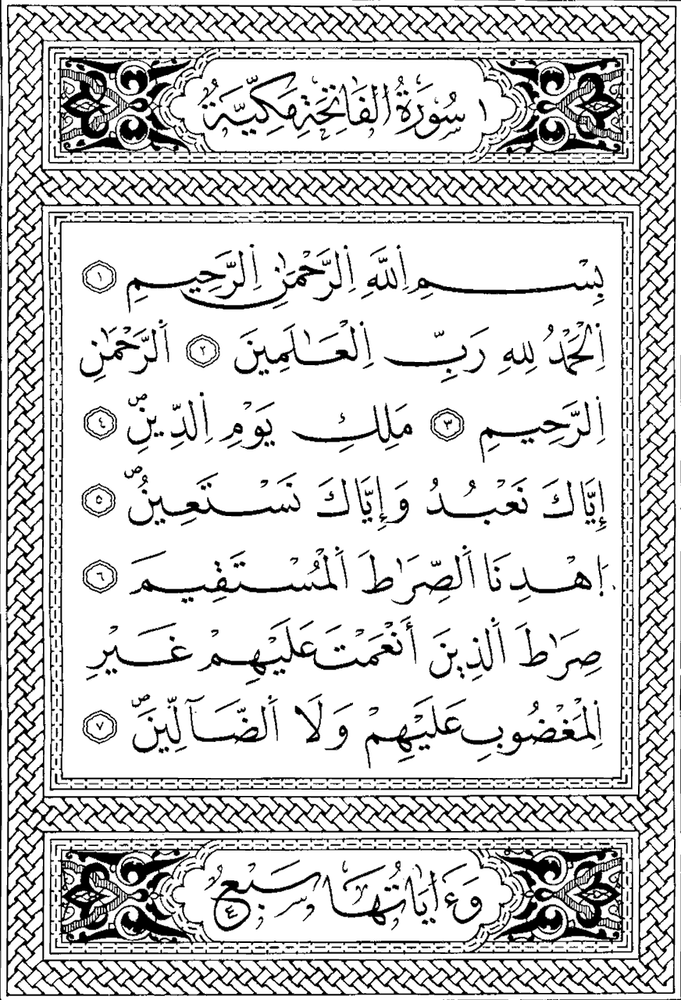

# مصحف الشاذلي - Mushaf Ashathili (الجزائر)

<p align="center">
  
  <br/>
  <em>سورة الفاتحة من مصحف الشاذلي (رواية ورش عن نافع)</em>
</p>

<p align="center">
  <a href="../../releases/latest">
    
  </a>
</p>

---

[العربية](#العربية) | [English](#english)

---

<a name="العربية"></a>
## العربية

### عن المصحف الشريف
يُعد **"مصحف الشاذلي"** (المعروف أيضاً بـ **طبعة الشاذلي** أو **المصحف الجزائري**) أحد أشهر وأعرق طبعات القرآن الكريم في الجزائر والمغرب العربي وإفريقيا. 

- **الرواية والرسم:** خُط وفق **رواية ورش عن نافع من طريق الأزرق**، معتمداً في الضبط على منظومة «مورد الظمآن» للإمام الشريشي الخراز، وفي عدّ الآيات على الطريقة الكوفية (وفق كتاب «البيان» للإمام أبي عمرو الداني).
- **الخطاط:** خطّه شيخ الخطاطين الجزائريين الدكتور **محمد بن سعيد شريفي** (رحمه الله)، بخط نسخ متقن وبديع ومحقق على القواعد الفنية الدقيقة.
- **تسمية الشاذلي:** تعود التسمية إلى طباعته ورعايته الرسمية في عهد الرئيس الجزائري الراحل **الشاذلي بن جديد** (طبعة عام 1984م الشهيرة الصادرة عن الشركة الوطنية للنشر والتوزيع)، حيث كان المصحف المعتمد رسمياً في المساجد والمعاهد والزوايا القرآنية بالجزائر، واكتسب مكانة وجدانية وتاريخية خاصة لدى الشعب الجزائري.

---

### تحميل المصحف بصيغة PDF (عبر GitHub Releases)
> 📥 **تحميل الملف الجاهز:**  
> لضمان بقاء المستودع خفيفاً وسريع التحميل، تم رفع النسخة الكاملة للمصحف بصيغة PDF (`Mushaf-Ashathili.pdf` بحجم 91.3 ميجابايت، 606 صفحة موحدة القياس) كملف ملحق ضمن قسم الإصدارات:  
> **👉 [اضغط هنا لتحميل مصحف الشاذلي PDF من صفحة الإصدارات (Releases)](../../releases/latest)**

---

### مصدر النسخ الضوئية الأصلية (Source Attribution)
> **ملاحظة تاريخية هامة حول المصدر:**  
> يُشار إلى أن النسخ الضوئية الأصلية (الموجودة في مجلد `pngs/`) مأخوذة في الأصل من **مجمع الملك فهد لطباعة المصحف الشريف بالمدينة المنورة** (المملكة العربية السعودية)، حيث كان المجمع يوفر هذه النسخة التاريخية بعينها بصيغة رقمية ضمن مستودع قديم على خوادمه وموقعه الإلكتروني، وهو المستودع الذي لم يعد متاحاً اليوم على شبكة الإنترنت.  
> وقد جرى جمع هذه الصفحات وتوثيقها ومعالجتها هنا بغرض الحفاظ على هذا التراث القرآني والتاريخي العظيم وإتاحته للباحثين والدارسين وعموم المسلمين في مشارق الأرض ومغاربها.

---

### محتويات المستودع
- **`pngs/`**: الصفحات الضوئية الأصلية الكاملة (606 صفحة من الفاتحة إلى الناس) كما حُفظت من المستودع القديم لمجمع الملك فهد.
- **`compile_mushaf.py`**: سكربت بلغة بايثون يقوم بقراءة الصفحات وتوحيد مقاساتها هندسياً إلى أبعاد موحدة (`1488 × 2207` بكسل) في مجلد محلي `pngs_normalised/`، ثم دمجها دون أي فقدان للجودة في ملف PDF نهائي.
- **`requirements.txt`**: الحزم البرمجية المطلوبة لتشغيل سكربت التجميع (`Pillow` و `img2pdf`).

---

### طريقة التوليد محلياً (للمطورين)
إذا أردت توليد الصفحات الموحدة وملف الـ PDF على جهازك:

```bash
# تثبيت المتطلبات
pip install -r requirements.txt

# تشغيل المعالجة وتوليد ملف PDF الموحد
python compile_mushaf.py
```
يقوم السكربت تلقائياً بإنشاء مجلد `pngs_normalised/` وتوليد ملف `Mushaf-Ashathili.pdf`.

---

<a name="english"></a>
## English

### Overview
**Mushaf Ashathili** (Arabic: **مصحف الشاذلي**, also referred to as *The Algerian Mushaf* or *Chadli Edition*) is one of the most prominent historical and celebrated prints of the Holy Quran in Algeria and North Africa.

- **Recitation & Orthography:** In accordance with the recitation of **Warsh 'an Nafi' (via Al-Azraq)**, meticulously vocalized using the rules of *Mawrid Adh-Dham'an* by Imam Al-Kharraz, and following the Kufic verse-numbering system via Imam Ad-Dani's *Al-Bayan*.
- **Calligrapher:** Hand-written by the renowned Algerian master calligrapher, **Dr. Mohamed Cherifi (محمد بن سعيد شريفي)**, in elegant, highly legible 15-line Naskh script.
- **Historical Background:** The name *Ashathili* originates from the era of former Algerian President **Chadli Bendjedid** (specifically the acclaimed 1984 state publication by SNED/ENAG). It served as the primary official Mushaf across mosques, Quranic schools, and scholarly circles throughout Algeria for decades.

---

### Download the PDF (via GitHub Releases)
> 📥 **Direct Download:**  
> To keep the git repository lightweight and fast to clone, the pre-compiled PDF (`Mushaf-Ashathili.pdf`, ~91.3 MB, 606 normalized pages) is published as a direct download under **GitHub Releases**:  
> **👉 [Download Mushaf-Ashathili.pdf from the Releases Page](../../releases/latest)**

---

### Original Scans Provenance & Attribution
> **Important Historical Provenance:**  
> The original high-resolution digital scans provided in the `pngs/` directory originated from the **King Fahd Glorious Quran Printing Complex** in Madinah, Kingdom of Saudi Arabia (مجمع الملك فهد لطباعة المصحف الشريف بالمدينة المنورة).  
> The Complex previously hosted this exact Algerian Mushaf under an older online archive/repository on their official web services, which is **no longer available on the web**.  
> These assets are preserved and published here for public benefit, educational research, and long-term digital preservation of this Islamic cultural heritage.

---

### Repository Structure
- **`pngs/`**: The complete raw original scans (606 pages, from Surah Al-Fatihah to Surah An-Nas) preserved exactly as retrieved from the historical King Fahd Complex archive.
- **`compile_mushaf.py`**: Automated Python pipeline that normalizes the pages to shared uniform dimensions (`1488 × 2207` pixels) into a local `pngs_normalised/` folder and losslessly compiles the final publication-ready PDF.
- **`requirements.txt`**: Python dependencies required for the build pipeline (`Pillow` and `img2pdf`).

---

### Build Instructions
To reproduce the normalized pages and PDF locally:

```bash
# Install dependencies
pip install -r requirements.txt

# Execute normalization and PDF compiler
python compile_mushaf.py
```
This script automatically generates the `pngs_normalised/` directory and outputs `Mushaf-Ashathili.pdf`.

---

### Specification Summary
| Property | Value |
| :--- | :--- |
| **Title** | Mushaf Ashathili (مصحف الشاذلي) |
| **Recitation (Qira'ah)** | Warsh 'an Nafi' via Al-Azraq (ورش عن نافع من طريق الأزرق) |
| **Calligrapher** | Dr. Mohamed Cherifi (د. محمد بن سعيد شريفي) |
| **First/Historic Edition** | Algiers, Algeria (1984 / 1404 AH) |
| **Page Layout** | 15 lines per page |
| **Total Quran Pages** | 606 pages (Surah Al-Fatihah to Surah An-Nas) |
| **Normalized Dimensions** | 1488 × 2207 pixels |
| **PDF Distribution** | Available as a standalone asset under [GitHub Releases](../../releases) |
| **Original Digital Archive** | King Fahd Glorious Quran Printing Complex, Madinah (Legacy Repo) |

---

### License & Digital Preservation
The text of the Holy Quran is in the public domain. This digital repository is dedicated to the preservation, accessibility, and study of Islamic calligraphic and printing heritage for Muslims, students, and researchers worldwide.
